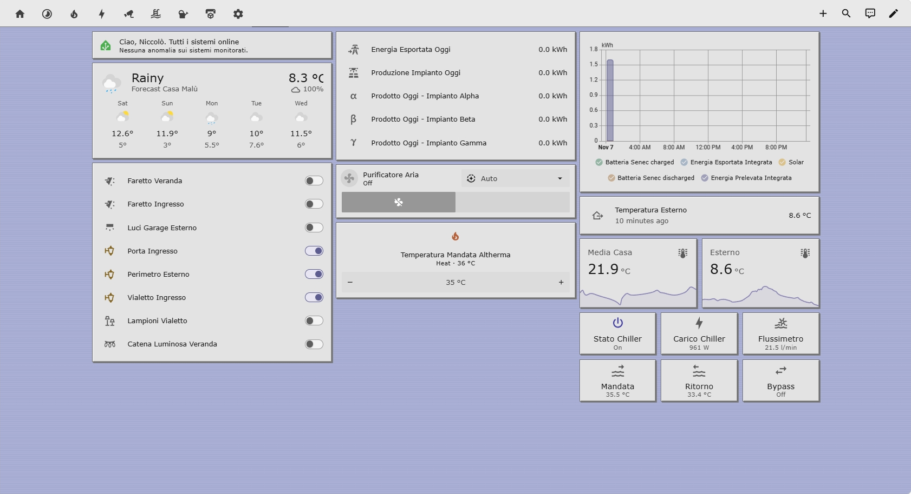
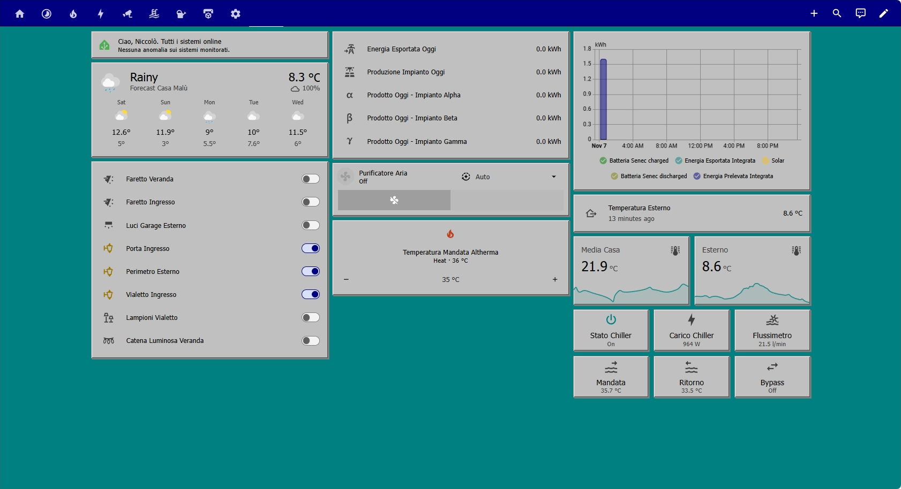
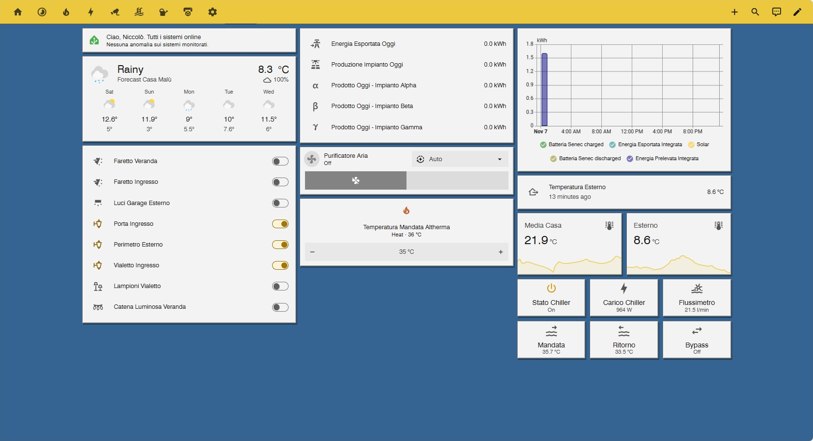
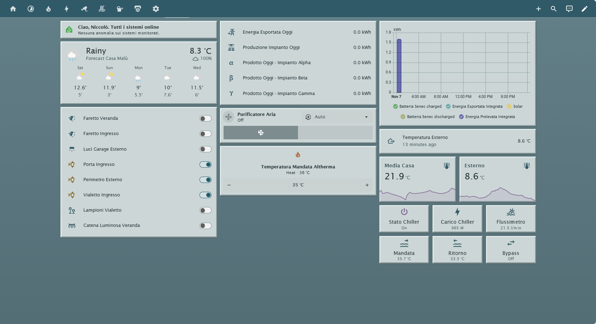
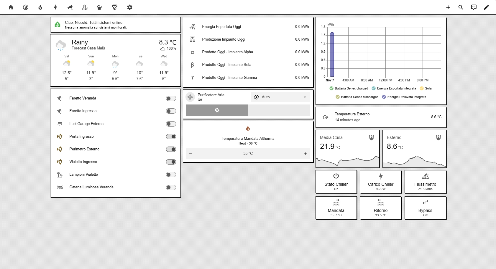
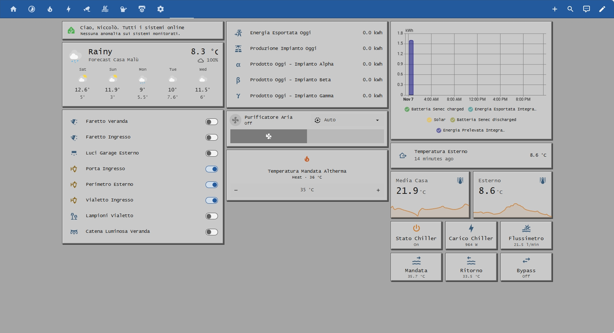

# Retro OS Themes — Home Assistant Edition

[](https://my.home-assistant.io/redirect/marketplace_repository/?owner=Tropie1988&repository=home-assistant-retro-themes&category=theme)

**Sixteen classic operating-system-inspired themes for Home Assistant**, from Windows 3.1 through Mac OS X 10.0, BeOS, Solaris CDE, OS/2 Warp, Amiga Workbench and Lisa OS.

The themes use native Home Assistant YAML: **no custom cards or frontend dependencies**. Each theme has its own selectable name in the profile, but the Marketplace installs a single generated YAML bundle.

## Real Home Assistant screenshots

Screenshots supplied by the maintainer from the same running dashboard, cropped to remove the sidebar with the test navigation label removed. Cards, entities and dashboard layout are examples and are not included with the themes.

### Mac OS 8 Platinum



<details>
<summary>More real screenshots: Windows, BeOS, Solaris, Macintosh and Amiga</summary>

### Windows Classic



### BeOS R5 Tracker



### Solaris CDE Motif



### Classic Macintosh



### Amiga Workbench 2.x



</details>

Installation as a custom HACS repository and delivery of the Mac OS 8 Platinum update have been confirmed by the maintainer.

## Themes included

| Family | Theme names |
| --- | --- |
| Windows | Windows 3.1 Program Manager · Windows 95 Classic · Windows 98 Classic · Windows NT 4.0 Workstation · Windows 2000 Professional · Windows XP Luna Blue |
| Classic Mac | Macintosh System 6 Monochrome · Macintosh System 7 Classic · Mac OS 8 Platinum · Mac OS 9 Platinum |
| Modern Mac | Mac OS X 10.0 - Cheetah Aqua |
| Other classics | OS2 Warp 4 Merlin · Amiga Workbench 2.x · Solaris CDE Motif · BeOS R5 Tracker · Apple Lisa Office System |

## Install

### Marketplace (Home Assistant 2026.11 or later)

1. Open **Settings → Marketplace** in Home Assistant.
2. Add this GitHub repository as a **custom repository** of type `theme` if it has not yet been accepted into the catalog.
3. Install **Retro OS Themes — Home Assistant Edition**.
4. Go to your **user profile → Theme** and choose any of the 16 themes.

### Manual install

1. Download [`themes/retro_os_collection.yaml`](themes/retro_os_collection.yaml).
2. Copy it into your Home Assistant configuration folder as `/config/themes/retro_os_collection.yaml`.
3. Ensure `configuration.yaml` includes the following; do not duplicate an existing `frontend:` block:

```yaml
frontend:
  themes: !include_dir_merge_named themes
```

4. Run the `frontend.reload_themes` action, or restart Home Assistant.
5. Select a theme from your **user profile**.

> The `!include_dir_merge_named` tag belongs in **Home Assistant configuration.yaml only**. The installable theme file itself has no custom YAML tags.

## What these themes change

The YAML reproduces original OS color schemes, square corners, classic window borders, shadows, typography *when fonts are locally available*, and themed card / sidebar / toolbar colors. A theme **cannot** recreate a functional Windows taskbar, Macintosh Finder, BeOS Deskbar, original system fonts on every device, or a full desktop UI. Some variables depend on the Home Assistant frontend version, the browser and the dashboard card in use.

## Development

The 16 individual theme source files are maintained in [`source/`](source/). The Marketplace expects **one theme YAML file per repository**, so [`tools/build.py`](tools/build.py) concatenates them into [`themes/retro_os_collection.yaml`](themes/retro_os_collection.yaml), preserving each original theme's variables.

```bash
python tools/build.py
python -m pip install PyYAML
python tools/validate.py
python tools/build.py --check
```

The CI workflow also runs [`hacs/action`](https://github.com/hacs/action) with `category: theme`. Never edit the generated `themes/retro_os_collection.yaml` directly — edit the individual source and rebuild.

## Testing checklist before the first catalog release

- [x] Test installation and theme updates as a custom HACS repository.
- [ ] Verify all 16 themes appear individually in the profile.
- [ ] Check visibility and contrast on mobile and desktop, light-themed and dark-themed cards.
- [ ] Test sections view, sidebar, dialogs and form controls.
- [x] Add **real Home Assistant screenshots** to the README.
- [ ] Add GitHub repository description, topics and enable Issues.
- [ ] Confirm the HACS GitHub Action passes with no ignored checks.
- [ ] Publish the first stable GitHub Release (`v1.0.0`) and submit a catalog PR to [`hacs/default`](https://github.com/hacs/default).

## Attribution & license

The visual themes are original configurations inspired by the look and feel of historical operating systems. They are **not endorsed by Microsoft, Apple, Be Inc., Sun Microsystems, IBM, Commodore or Amiga rights holders**. No proprietary OS artwork, system font binaries, or brand logos are shipped.

Source code is offered under the MIT License; see [LICENSE](LICENSE).

## Official publishing documentation

- [Home Assistant Marketplace: publishing themes](https://contributors.home-assistant.io/marketplace/guides/themes/)
- [Repository structure](https://contributors.home-assistant.io/marketplace/reference/repository-structure/)
- [Catalog submission](https://contributors.home-assistant.io/marketplace/guides/catalog/)
